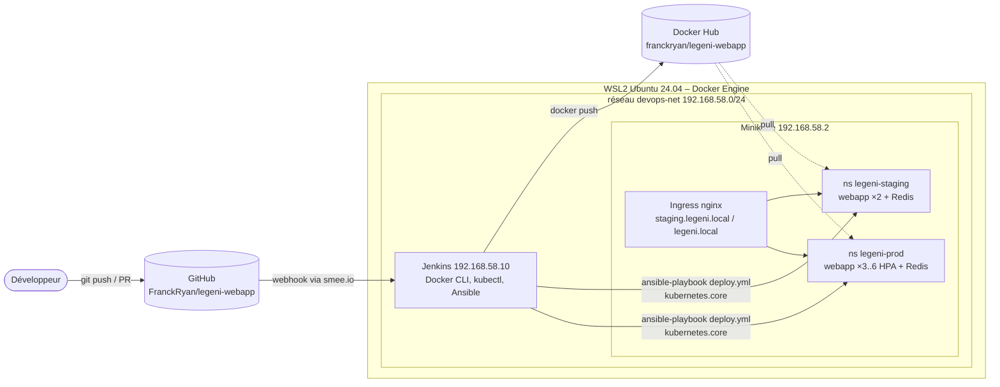

# Rapport – Projet final DevOps : chaîne CI/CD « du commit à la production »

**Étudiant :** CHAMEN NKONGMENECK Franck Ryan – B3 IABD
**Dépôt :** https://github.com/FranckRyan/legeni-webapp – **Image :** https://hub.docker.com/r/franckryan/legeni-webapp

> Les emplacements « 📸 Capture » sont à remplacer par les captures d'écran de la démonstration.

---

## 1. Architecture

Option A du sujet : **une seule machine** (Windows 11 + WSL2 Ubuntu 24.04, 7 Go de RAM dont 4 Go pour WSL) héberge Jenkins et Minikube. Tous les conteneurs partagent le réseau Docker `devops-net` (192.168.58.0/24), ce qui permet à Jenkins de joindre directement l'API Kubernetes.



| Composant | Adresse | Rôle |
|---|---|---|
| Jenkins | 192.168.58.10, http://localhost:8080 | CI/CD, pilote Docker (socket), Ansible et kubectl |
| Minikube | 192.168.58.2, API :8443 | cluster Kubernetes mono-nœud (addons metrics-server, ingress) |
| legeni-staging | NodePort 30081, `staging.legeni.local` | 2 réplicas, bannière orange |
| legeni-prod | NodePort 30082, `legeni.local` | 3 à 6 réplicas (HPA), bannière verte, CronJob de santé |

📸 Capture : `docker network inspect devops-net` / `kubectl get all -n legeni-prod`

## 2. Choix techniques

| Sujet | Choix | Justification |
|---|---|---|
| Infrastructure | WSL2 + Docker Engine (sans Docker Desktop) | gratuit, identique à une VM Ubuntu ; tout est installé par `provision.yml` |
| Réseau | réseau Docker `devops-net` à sous-réseau fixe | Jenkins joint l'API Kubernetes sans `docker network connect` manuel ; adresses fixes stables après redémarrage |
| Image | multi-stage `base → test → runtime` | les tests tournent dans le build ; l'image finale ne contient ni outils de test ni code inutile |
| Tags | `<VERSION>-<build>` (ex. `1.1.0-37`), jamais `latest` | chaque image désigne un build et un commit précis ; rollback fiable |
| Manifests | templates Jinja2 rendus par Ansible (`kubernetes.core.k8s`) | une seule source pour 2 environnements ; variables dans `vars/staging.yml` et `vars/prod.yml` |
| Secrets | Ansible Vault (`vars/vault.yml`) + credentials Jenkins | aucun mot de passe en clair dans Git ni dans le Jenkinsfile |
| Redis | StatefulSet + PVC | identité et volume stables : le compteur survit aux redémarrages |
| Mise à jour | RollingUpdate `maxSurge 1 / maxUnavailable 0` + readinessProbe `/ready` | un ancien pod n'est retiré que lorsqu'un nouveau est prêt : 0 coupure |
| Rollback | `block / rescue` + `k8s_rollback` | automatique dès que le rolling update ou le smoke test échoue |
| Webhook | relais smee.io | GitHub ne peut pas joindre `localhost` |
| Notification | Discord (webhook) | simple, sans serveur SMTP |

## 3. Lot par lot

### Lot 0 – Git
- Branche `main` protégée (règle GitHub : *Require status checks* = `continuous-integration/jenkins/branch`) : merge uniquement par pull request avec build vert.
- Chaque évolution dans une branche `feature/...` ; ce projet lui-même a été livré par la branche `feature/projet-final`.
- Un tag `v<VERSION>` est créé **automatiquement par le pipeline** à la première mise en production d'une version (stage *Tag Git*).

### Lot 1 – Conteneurisation (`Dockerfile`)
- Étape `test` : `flake8` + `pytest` ; étape `runtime` minimale (`python:3.12-slim`).
- Utilisateur `appuser` (uid 10001), `HEALTHCHECK` sur `/health`, `ARG APP_VERSION` injecté au build, `CMD` en forme exec (gunicorn reçoit SIGTERM : arrêt propre).
- Configuration uniquement par variables d'environnement (`APP_ENV`, `APP_COLOR`, `REDIS_*`).
- `hadolint` sans erreur, Trivy 0 vulnérabilité CRITICAL corrigeable (stage bloquant).

### Lot 2 – Infrastructure as Code (`ansible/provision.yml`)

| Rôle | Ce qu'il installe |
|---|---|
| `docker` | Docker CE depuis le dépôt officiel, utilisateur dans le groupe `docker`, bibliothèques Python des modules |
| `reseau` | réseau `devops-net` (sous-réseau, passerelle et plage dynamique fixes) |
| `minikube` | kubectl et minikube (versions figées), cluster sur `devops-net`, addons `metrics-server` et `ingress` |
| `jenkins` | image du TP 3.1 (Docker CLI, kubectl, Ansible, plugins), Compose, attente de disponibilité, kubeconfig déposé dans Jenkins |

- Variables dans `defaults/`, dépendances dans `meta/` (`minikube` et `jenkins` dépendent de `reseau`, qui dépend de `docker`).
- **Idempotence** : 2ᵉ exécution `changed=0` (les vérifications ont `changed_when: false`).
- Secrets : `vars/vault.yml` chiffré (`$ANSIBLE_VAULT;1.1;AES256`), créé par `scripts/init_vault.sh`.

📸 Capture : PLAY RECAP de la 2ᵉ exécution (`changed=0`) ; `head -1 ansible/vars/vault.yml`

### Lot 3 – Déploiement Kubernetes (`ansible/deploy.yml`)
1. Namespace, Secret `redis-secret` (valeur du Vault, `no_log`), Secret TLS.
2. Redis : StatefulSet + PVC, sondes et ressources ; attente qu'il soit prêt.
3. **Job de migration** `migration-<version>` (bonus) : attend Redis, initialise le compteur, enregistre la version de schéma ; attente `condition=Complete` **avant** le rolling update.
4. Application dans un `block` : apply + **attente de la fin du rolling update** (`wait: true`), puis **smoke test** exécuté dans un pod : `/api/info` doit renvoyer la version déployée et `/ready` 200.
5. `rescue` : `k8s_rollback` vers la révision précédente, attente de sa disponibilité, puis échec explicite (pipeline rouge).
6. Bonus : Ingress HTTPS, HPA (prod, 3 → 6 réplicas, CPU 50 %), CronJob de contrôle de santé toutes les 5 min (prod).

| | staging | prod |
|---|---|---|
| Namespace | `legeni-staging` | `legeni-prod` |
| Réplicas | 2 | 3 à 6 (HPA) |
| Couleur | orange `#bf8700` | vert `#2da44e` |
| Accès | NodePort 30081, `https://staging.legeni.local` | NodePort 30082, `https://legeni.local` |

📸 Capture : `kubectl get all,pvc,ingress,hpa,cronjob -n legeni-prod`

### Lot 4 – Intégration continue (`Jenkinsfile`, job multibranch `legeni-webapp-mb`)

| Stage | Branches | Rôle | Bloquant si… |
|---|---|---|---|
| Version | toutes | lit `VERSION`, calcule `<VERSION>-<build>` | – |
| Qualité (parallèle) | toutes | tests + couverture ≥ 80 % (JUnit, Coverage), flake8 (Warnings NG), hadolint, `--syntax-check` Ansible | un contrôle échoue |
| Build image | toutes | `docker build --build-arg APP_VERSION` | erreur de build |
| Scan Trivy | toutes | CRITICAL corrigeables | ≥ 1 trouvée |
| Push Docker Hub | **main** | `franckryan/legeni-webapp:<VERSION>-<build>` | – |

- Déclenchement : webhook GitHub (push + pull requests) relayé par smee.io ; scan périodique en secours.
- Credentials Jenkins : `registry-credentials`, `kubeconfig` (Secret file), `ansible-vault-pass` (Secret file), `discord-webhook`, `github`. Aucun secret dans le dépôt.

📸 Capture : Stage View d'une PR (sans déploiement) ; rapports Tests / Coverage / Flake8

### Lot 5 – Déploiement continu
- `main` uniquement : staging automatique → `input` « Déployer la version … en production ? » (30 min max) → production → tag Git.
- Les branches `feature/*` et les PR s'arrêtent après le scan : stages de push et de déploiement *skipped*.
- `disableConcurrentBuilds()` : jamais deux déploiements simultanés.
- Notification Discord en cas d'échec (lien vers la console).

📸 Capture : bouton de validation ; message Discord d'échec

## 4. Scénario de soutenance

| # | Action | Résultat attendu |
|---|---|---|
| 1 | Branche `feature/couleur-1.1.0` : `APP_COLOR` par défaut modifiée, `VERSION` = `1.1.0`, PR | PR verte, aucun déploiement ; après merge : staging 1.1.0-n, validation, prod 1.1.0-n ; `scripts/boucle_prod.sh` : **0 erreur** ; tag `v1.1.0` créé |
| 2 | Test qui échoue (`assert response.status_code == 500`) | stage *Tests + couverture* rouge, *Build image* jamais exécuté, aucune image, prod inchangée, message Discord |
| 3 | `readiness_path: /inexistant` dans `deploy.yml` | staging : pods jamais prêts, `rescue` → *Retour à la version précédente*, pipeline rouge, staging et prod toujours servis par la version précédente |

Commandes utiles pendant la démonstration :
```bash
bash scripts/boucle_prod.sh                         # boucle curl sur la prod (Ctrl+C = bilan)
kubectl rollout history deployment/webapp -n legeni-prod
kubectl get pods -n legeni-staging -w
bash scripts/charge_hpa.sh                          # bonus HPA
curl -k --resolve legeni.local:443:$(minikube ip) https://legeni.local/api/info   # bonus Ingress TLS
```

📸 Captures : boucle curl (0 erreur) ; pipeline rouge à l'étape tests ; console du rollback

## 5. Difficultés rencontrées et solutions

| Difficulté | Cause | Solution |
|---|---|---|
| Téléchargements interrompus (Git, `apk`, base Trivy) | connexion lente et instable | relance du build ; `apk` limité au dépôt `main` ; base Trivy téléchargée une fois dans le volume `trivy_cache` puis `--skip-db-update` |
| Trivy bloquait la publication de l'image nginx du TP 3.4 | 3 failles CRITICAL corrigées (OpenSSL, brotli) | `apk upgrade` dans l'image : la porte de qualité a joué son rôle |
| RAM limitée (7 Go) | Minikube + Jenkins + lab simultanés | WSL limité à 4 Go par `.wslconfig`, Minikube à 2,6 Go, services arrêtés selon le TP |
| WSL perd le réseau après une veille | réseau virtuel de WSL | `wsl --shutdown` puis relance de l'environnement |
| `smee-client` 5 incompatible | Node.js 18 d'Ubuntu 24.04 | `npx smee-client@1.2.5` |
| Erreur Jenkins 403 « No valid crumb » | page de configuration ouverte avant un redémarrage de Jenkins | recharger la page avant d'enregistrer |
| Commits partis sur la mauvaise branche | `git checkout -b` resté actif | `git checkout main` + `git cherry-pick` |
| `docker inspect jenkins` renvoyait 2 réseaux | Jenkins sur `default` et `devops-net` | Jenkins uniquement sur `devops-net` (override Compose) |

## 6. Pistes d'amélioration
- GitOps avec Argo CD : Jenkins ne modifierait que le tag dans Git.
- Supervision Prometheus + Grafana (`kube-prometheus-stack`).
- Registre privé et signature des images (cosign).
- Agents Jenkins éphémères dans Kubernetes au lieu de l'exécuteur intégré.
- Sauvegarde planifiée du volume Redis de production.
